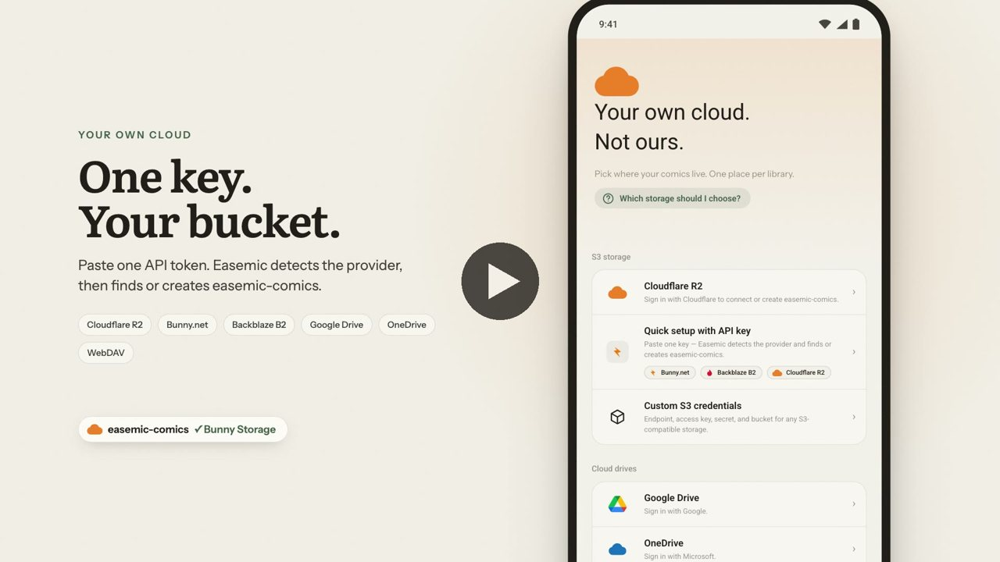
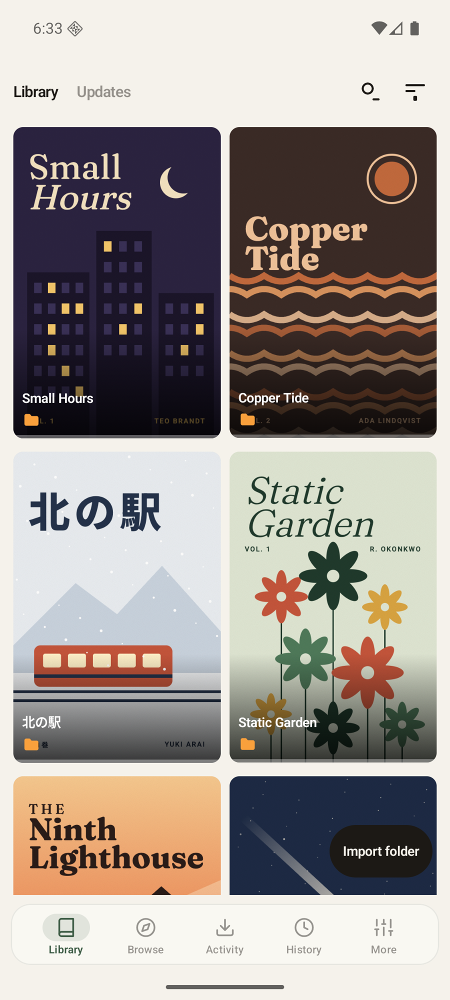
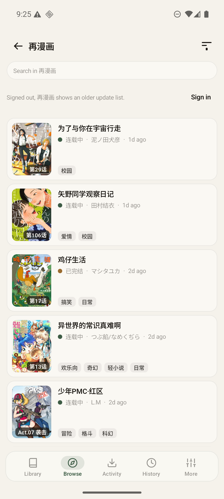
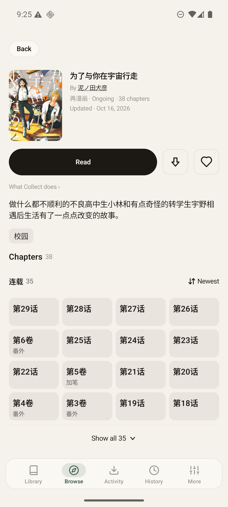
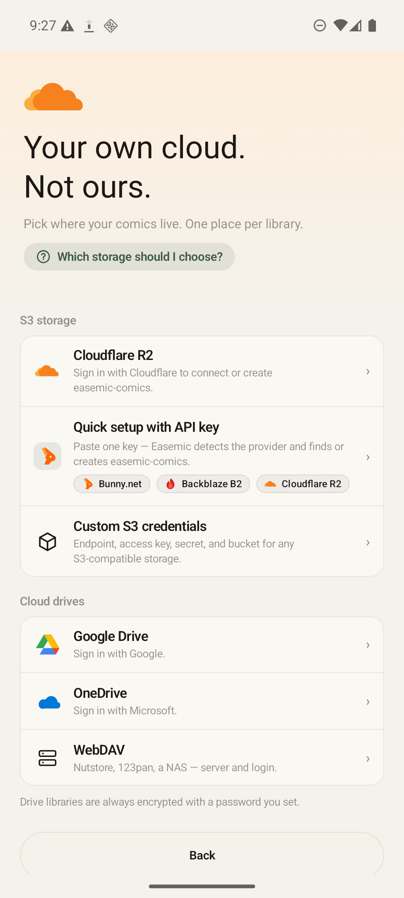

<div align="center">

# Easemic

**Read straight from your own cloud.**

A native Android comic and manga reader that collects galleries and serialized series into cloud storage you own—and streams every page on demand.

[](https://alternativeto.net/software/easemic/about/)

[**Website**](https://easemic.com) · [**Download APK**](https://easemic.com/api/app/download) · [**Cloud Speed Benchmarks**](https://easemic.com/guides/cloud-reading-speed/) · [**Storage Guides**](https://easemic.com/guides/) · [**Get an API key**](https://easemic.com/guides/cloud-storage-api-key/)

</div>

---

<p align="center">
  <a href="https://easemic.com/#film"></a>
</p>

<p align="center">
  
  
  
  
</p>

## Why Easemic?

- **Stream Straight from Your Cloud (Zero Phone Bloat)** — Turn on *Keep only the cloud copy* to release local storage right after uploading. Pages stream directly from your bucket or drive in milliseconds (123 ms median first-page open on Bunny Storage, 199 ms on Cloudflare R2) with a bounded local cache.
- **Takedown-Proof Shelf** — Once collected, a gallery or manga chapter lives in your own storage. If a gallery vanishes upstream or a serialized chapter is replaced or removed, your saved copy stays readable on your shelf and removed chapters are clearly marked `Removed`.
- **One Shared Shelf Across Devices & New Phones** — Connect a second phone, a tablet, or a brand-new phone to the same storage and your entire collected library and covers appear immediately—no multi-gigabyte folder transfers required.
- **Client-Side Encryption** — Libraries on Google Drive, OneDrive, and WebDAV are always encrypted on your device with your password before upload; on S3-compatible storage, encryption is your choice. Your keys never leave your phone.
- **1-Key S3 Auto-Setup** — Paste a single API token for **Cloudflare R2**, **Bunny.net**, or **Backblaze B2** and Easemic automatically detects the provider, provisions or binds your `easemic-comics` bucket, and derives credentials—or sign in to Google Drive, OneDrive, or any WebDAV server (Nutstore, 123pan, NAS).

## Features

- **Galleries & Serialized Manga in One App** — Built-in gallery catalogs (`E-Hentai`, `ExHentai`, `nhentai`) alongside multi-chapter serialized manga (`再漫画`, `禁漫天堂`) with background new-chapter checks (`+N` shelf badges) and one-tap ExHentai favorites import.
- **Dual-Engine Webtoon & Manga Reader** — Automatically detects long-strip webtoons/manhwa (`height / width >= 2.15`) for full-width vertical scrolling with **5-speed hands-free auto-scroll** (touch to pause, lift to resume), right-to-left manga paging, animated GIF/WebP support, and instant first-frame resume cache.
- **Self-Hosted OPDS & Local Archives** — Browse, stream, or collect from your own **Kavita** or **Komga** server over OPDS, and import local image folders, `CBZ`/`ZIP` archives (with `ComicInfo.xml`), or existing `.ehviewer` download directories.
- **Smart Cloud Hygiene** — Optional perceptual-hash (`dHash`) + semantic trailing sponsor-ad stripping on cloud upload (preserves scanlation credit pages).
- **4 Languages & In-App Updates** — Live in-app language switching (`Follow system`, `English`, `简体中文`, `繁體中文`, `日本語`) and built-in APK streaming updates with `SHA-256` + package archive verification.

## Download

Download the latest signed Android APK (Android 10 / API 29+):

- **Direct APK:** [`https://easemic.com/api/app/download`](https://easemic.com/api/app/download)
- **GitHub Releases:** [github.com/dirtyfancy/easemic/releases](https://github.com/dirtyfancy/easemic/releases)

Easemic checks `easemic.com` once a day for newer releases and updates in place inside the app.

## Build from Source

Requires JDK 17+ and the Android SDK (compile SDK 37).

```bash
./gradlew :app:assembleDebug
```

The unit and device test suites are not in this repository yet: their fixtures were recorded from live catalogs and
are being rewritten with synthetic data first.

## Privacy & Independence

- **No accounts, no tracking, no ads.** Easemic has no user accounts, no analytics SDKs, and no middleman servers. Your credentials and comics travel strictly between your device and the storage you configure.
- **Clean-room implementation.** Built from scratch in Kotlin and Jetpack Compose. Not affiliated with any upstream catalog or storage provider.

## Community

Easemic is shared with and recognizes the [LINUX DO](https://linux.do) community.
本项目认可并感谢 [LINUX DO 社区](https://linux.do)。

## License

Licensed under the [Apache License 2.0](LICENSE).
