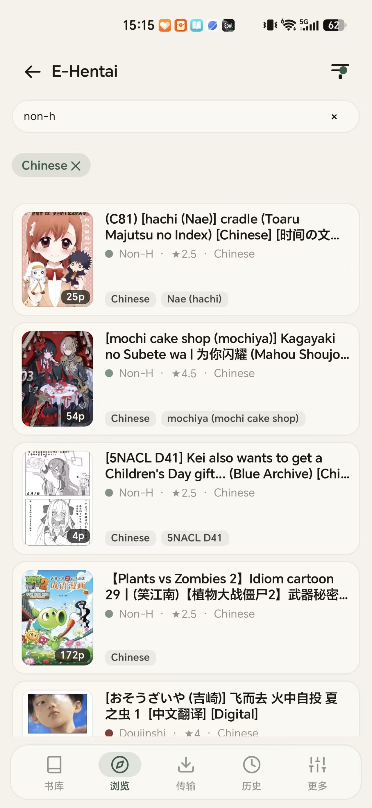
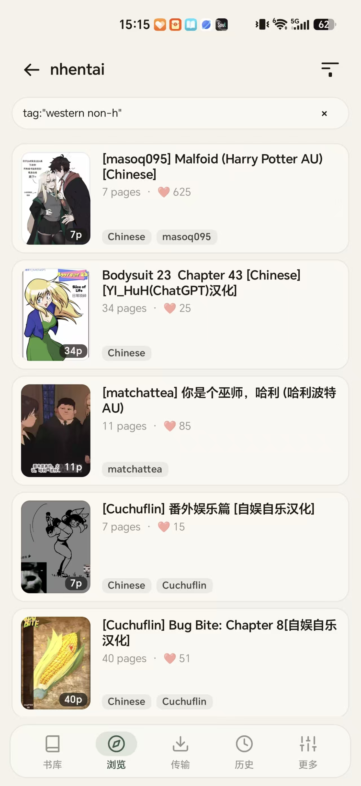
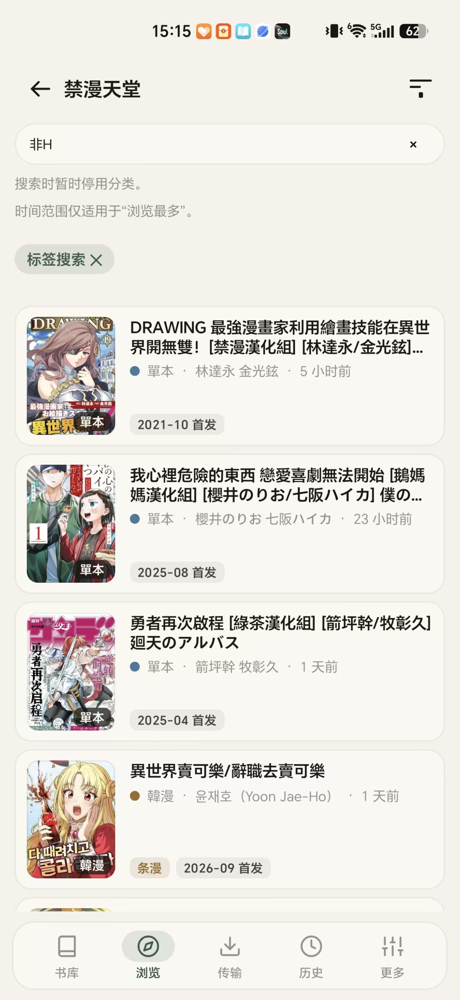

<p align="center">
  
</p>

<h1 align="center">Easemic</h1>

<p align="center">给自己用的私人漫画与本子云书库：E-Hentai、nhentai、禁漫天堂、再漫画与自建 OPDS，收进你自己的加密云盘直连秒看。</p>

<p align="center">
  <a href="https://easemic.com">官网</a> ·
  <a href="https://easemic.com/api/app/download">下载 APK</a> ·
  <a href="https://github.com/dirtyfancy/easemic/releases">GitHub Releases</a> ·
  <a href="https://easemic.com/#film">25秒演示短片</a> ·
  <a href="https://easemic.com/guides/cloud-reading-speed/">云端翻页实测</a> ·
  <a href="https://easemic.com/guides/cloud-storage-api-key/">网盘配置教程</a> ·
  <a href="https://github.com/dirtyfancy/easemic/issues">问题反馈</a> ·
  <a href="README.en.md">English</a>
</p>

<p align="center">
  <a href="https://github.com/dirtyfancy/easemic/releases"></a>
  <a href="LICENSE"></a>
  <a href="https://easemic.com/api/app/download"></a>
  <a href="https://alternativeto.net/software/easemic/about/"></a>
  
</p>

> **18+** 本项目包含成人图站连接能力，仅供成年人管理自己的个人漫画馆藏。仓库不含任何媒体文件或站点数据；连接外部站点需自备相应账号与网络访问权限。

<p align="center">
  <a href="https://easemic.com/#film"></a>
</p>

## 能做什么

- **本子与连载一处通吃**：内置画廊源（**E-Hentai**、**ExHentai**、**nhentai**）与多章节连载漫画源（**禁漫天堂 JMComic**、**再漫画**），支持自建 **Kavita / Komga (OPDS)** 书库，一个 App 同时刷单本画廊与追更长篇连载。
- **收进云盘、手机零占用**：在详情页点一下右上角云朵，即可把画廊或连载章节直接收进你自己的 **Cloudflare R2**、**Bunny Storage**、**Backblaze B2**、**Google Drive**、**OneDrive** 或 **WebDAV**（坚果云、123云盘、群晖 NAS）。开启「仅保留云端副本」后，上传完成即自动释放手机本地空间。
- **云端直连秒翻页**：阅读时按页直连云盘流式加载（Bunny 中位首帧 123 ms，Cloudflare R2 199 ms），支持前后页预取、动图（GIF / WebP）原位播放与上次阅读首帧瞬开缓存，体验与读本地文件无异。
- **防爆菊、防删库**：作品一旦收进你自己的云盘，就算上游画廊被删（Sad Panda / 版权下架）或连载章节被替换、屏蔽，你书架上的云端副本依然随时可读，被上游移除的章节会自动标出 `Removed` 提醒。
- **换机、多端零迁移**：新手机或平板绑上同一个云盘，整座书架、封面、阅读进度与书签当场出现，从此告别换手机导几百 GB 文件夹的痛苦。
- **客户端端到端加密**：Google Drive、OneDrive 与 WebDAV 上的馆藏默认在手机本机用你的密码加密后再上传（防网盘和谐与审查）；S3 对象存储（R2 / Bunny / B2）可自由选择明文或加密。密钥永不离开你的手机。
- **一键接手 EhViewer 与本地收藏**：支持直接导入现有的 `.ehviewer` 下载目录、本地图片文件夹以及含 `ComicInfo.xml` 的 `CBZ` / `ZIP` 压缩包，还支持一键导入 ExHentai 云端收藏夹。
- **条漫 / 日漫双引擎阅读器**：按画面宽高比（`height / width >= 2.15`）自动识别韩漫/条漫并切换全宽无缝纵滚，内置 **5 档免手滑自动滚动**（手指按住即停，松手继续），日漫支持从右至左翻页与双页拼合。
- **自动切掉末尾菠菜广告**：上传云端时可选开启感知哈希（`dHash`）+ 语义尾页识别，自动剥离汉化组尾页后面附带的赌博/赞助黑页广告，同时完整保留汉化组鸣谢页。
- **连载自动追更**：后台定时检查已收藏连载漫画的新章节，书架卡片直接亮起 `+N` 更新角标。

观看记录、书签和网盘密钥保存在本机与你自己的云存储中。应用不含任何账号体系、无中心服务器、无统计埋点、无广告。

## 截图

点击截图可查看原图。演示视频与云盘测速见 [easemic.com](https://easemic.com)。

<table>
  <tr>
    <td width="33%"><a href="docs/screenshots/browse-ehentai.jpg"></a></td>
    <td width="33%"><a href="docs/screenshots/browse-nhentai.jpg"></a></td>
    <td width="33%"><a href="docs/screenshots/browse-jmcomic.jpg"></a></td>
  </tr>
  <tr>
    <td align="center">E-Hentai / ExHentai：标签与语言筛选</td>
    <td align="center">nhentai：组合标签检索与汉化直达</td>
    <td align="center">禁漫天堂：单本、韩漫条漫与分类排行</td>
  </tr>
</table>

<table>
  <tr>
    <td width="50%"><a href="docs/screenshots/library-shelf.png"></a></td>
    <td width="50%"><a href="docs/screenshots/browse-serialized.png"></a></td>
  </tr>
  <tr>
    <td align="center">书库：本机与云盘馆藏合一，带更新角标与来源筛选</td>
    <td align="center">连载：再漫画等多源连载分类与排行榜</td>
  </tr>
  <tr>
    <td width="50%"><a href="docs/screenshots/detail-chapters.png"></a></td>
    <td width="50%"><a href="docs/screenshots/cloud-storage-picker.png"></a></td>
  </tr>
  <tr>
    <td align="center">详情页：标签点击搜同好、选章下载或一键收进云盘</td>
    <td align="center">云库绑定：粘贴单个 API Key 自动建桶，或绑网盘/WebDAV</td>
  </tr>
</table>

## 下载与使用

### Android 安装

1. 从 [官网直链](https://easemic.com/api/app/download) 或 [GitHub Releases](https://github.com/dirtyfancy/easemic/releases) 下载最新签名安装包 `easemic-<版本>.apk`（支持 Android 10 / API 29 及以上）。
2. 打开应用后，可在 **浏览** 页直接使用内置漫画源，或在 **更多 → 浏览设置** 中开启成人图站开关（E-Hentai / ExHentai / nhentai / 禁漫天堂）。
3. 如需开启云端书库，前往 **更多 → 云存储**，粘贴 Cloudflare R2 / Bunny / Backblaze B2 的单个 API Token（应用会自动识别服务商并创建或绑定 `easemic-comics` 存储桶），或登录 Google Drive / OneDrive / WebDAV。各家网盘的免费额度与申请步骤见 [网盘配置教程](https://easemic.com/guides/cloud-storage-api-key/)。

应用每天自动检查一次新版本，有更新时可在应用内直接校验 `SHA-256` 并流式升级。

### 从源码构建

需要 JDK 17+ 与 Android SDK（compile SDK 37）：

```bash
./gradlew :app:assembleDebug
```

## 常见问题

- **成人源（E-Hentai / nhentai / 禁漫天堂）在哪里打开？** 首次安装默认展示常规连载源（再漫画与 OPDS）。前往 **更多 → 浏览设置** 打开对应图站开关即可在浏览页看到全部入口；ExHentai 在输入里站账号或 Cookie 后自动解锁。
- **云盘哪个最省钱、最快？** **Cloudflare R2** 提供每月 10 GB 免费额度且免出站流量费；**Bunny Storage** 实测亚洲与全球节点翻页最快（中位首帧 123 ms）；已经买了 **Google Drive / OneDrive / 123云盘 / 坚果云** 会员的可以直接拿现成空间当加密漫画盘用。详细实测见 [云端翻页速度对比](https://easemic.com/guides/cloud-reading-speed/)。
- **发到网盘上的本子会被网盘和谐或封号吗？** 绑定 Google Drive、OneDrive 和 WebDAV 时，Easemic 强制在手机本地先用你的密码完成端到端加密再上传，网盘服务商看不到任何图片内容与原始文件名。S3 对象存储（R2 / Bunny / B2）也支持开启同样的客户端加密。
- **以前用 EhViewer 攒了一堆本地本子怎么迁过来？** 在书库页点右下角「导入文件夹」，选择你的 `.ehviewer` 下载目录或 `CBZ` / `ZIP` 文件夹，Easemic 会自动识别元数据入库；绑好云盘后还能一键把它们同步上云。
- **界面支持哪些语言？** 支持跟随系统、简体中文、繁體中文、English、日本語，可在设置中实时切换。

## 问题反馈

欢迎在 [GitHub Issues](https://github.com/dirtyfancy/easemic/issues) 提交 Bug 反馈或功能建议。附上应用版本、复现步骤与截图即可；截图中请遮挡你自己的网盘密钥与私人域名。

## 致谢与社区

本项目由 Kotlin 与 Jetpack Compose 从零独立编写，与各上游站点及云存储服务商无隶属关系。
感谢并认可 [LINUX DO 社区](https://linux.do)。

## 许可证

[Apache-2.0](LICENSE) · Copyright (C) 2026 Easemic.
